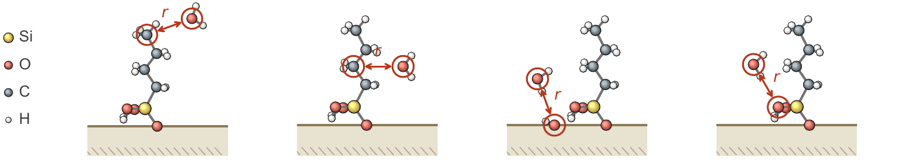

# RDFs, MSD and P of the first-shell water

From the trajectories of the wet systems to the cutoffs of the first hydration shell, the MSD and the contact survival
*P* of the first-shell water, and the water at each group of atoms.

<p align="center"></p>

The four RDFs of every system, from left to right: the terminal carbon of a chain (CH<sub>3</sub>), the other chain
carbons (CH<sub>2</sub>), the silanol oxygens of the silica and the oxygens of the head groups, each paired with the
water oxygens at the distance *r*.

## Steps

| Step | What it does | Writes |
|---|---|---|
| `step1_RDF.py` | RDFs of the water oxygens around CH<sub>3</sub>, CH<sub>2</sub>, the silanol oxygens and the head-group oxygens; first peaks and minima; the cutoffs of the first shell (median first minimum over the systems) | `results/RDF/` |
| `step2_MSD.py` | survival-conditioned lateral MSD at 20 ... 200 ps, with the SD of the ten 9-ns blocks | `results/MSD/` |
| `step3_P.py` | contact survival *P* at 20 ... 200 ps | `results/P/` |
| `step4_first_shell_water.py` | first-shell water per nm² at each group, per 9-ns block | `results/first_shell_water/` |
| `step5_tables.py` | all systems in tables; `msd_and_P.csv` is the input of `../ML_Classification` | `results/msd_and_P.csv`, `msd_and_P_all_lags.csv`, `first_shell_water_blocks.csv` |
| `step6_first_shell_means.py` | first-shell water of every system, mean and SD over the blocks | `results/first_shell_water.csv` |
| `step7_tables.py` | first-shell water at each group, mean over the chain lengths; MSD and *P* at 20 and 40 ps of a few coverages (needs step 1 of `../Region_MSD_and_P`) | `results/first_shell_water_mean_over_L.csv`, `msd_and_P_20_40ps.csv` |
| `plot_figures.py` | the figures | `figures/` |

Steps 1–4 read the trajectories (MDAnalysis, 8 systems at a time); `systems.py` holds the layout of the folder of the
simulations and finds the systems in it. The columns of every file are explained at the top of the scripts.

## Figures

<p align="center"></p>

First-shell water per nm² at the CH<sub>3</sub> and CH<sub>2</sub> groups and at the oxygens of the silica and the head
groups, mean over the chain lengths (band: SD over the chain lengths).

<p align="center"></p>

RDFs between the water oxygen and the four groups of atoms (columns), for every chain length (rows) and coverage
(colors).

## Run

```bash
python3 step1_RDF.py <folder of the simulations>
python3 step2_MSD.py <folder of the simulations>
python3 step3_P.py <folder of the simulations>
python3 step4_first_shell_water.py <folder of the simulations>
python3 step5_tables.py
python3 step6_first_shell_means.py
python3 step7_tables.py            # after step 1 of ../Region_MSD_and_P
python3 plot_figures.py
```
