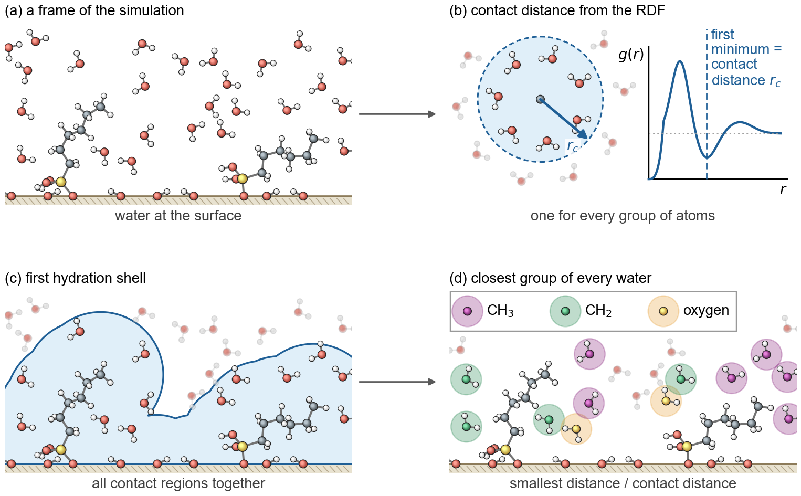
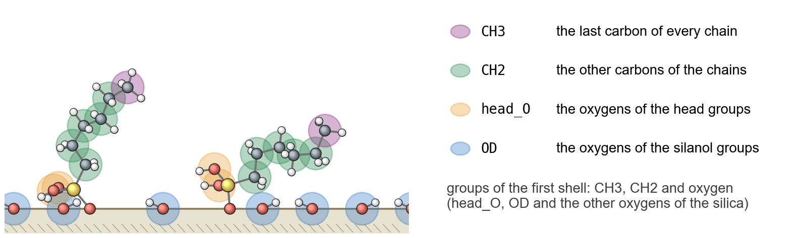
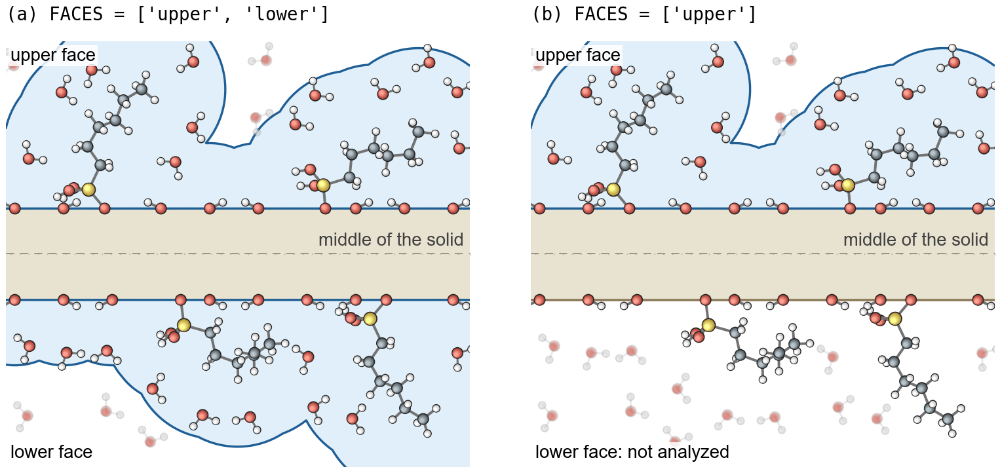

# surface-water-dynamics-ml

This code analyzes the water next to a surface in molecular dynamics simulations. It finds the first hydration shell
of the surface, measures how the water molecules move in this shell and how long they stay in it, and then uses
machine learning (k-means clustering) to sort a set of systems into regimes of the water dynamics.

The code works for any surface in water: a modified surface, a coating, a monolayer or a bare solid. Everything that
belongs to the system is in one file, `settings.py`: the atoms of the water and of the surface, the groups of atoms
that make the first shell, and the faces of the solid. As an example, `settings.py` holds our own systems:
self-assembled monolayers (SAMs) of alkylsilanes on both faces of a silica slab, in water.



## What the code computes

- The radial distribution functions (RDFs) of the water oxygens around groups of atoms of the surface. The first
  minimum of each RDF gives a contact distance.
- The first hydration shell: all water molecules whose oxygen is within the contact distance of an atom of the
  surface (picture above). A water molecule is counted once, also when it is close to several atoms, and it belongs to
  the group of atoms it is closest to.
- The water of the first shell at each group of atoms, per nm² of the surface.
- The lateral mean squared displacement (MSD) of the water molecules that stay in the first shell, in the plane of
  the surface.
- The contact survival probability *P*(τ): the fraction of the first-shell water molecules that are still in the shell
  after the lag time τ, without leaving it in between.
- MSD and *P* for regions of the first shell, for example the water at one group of atoms, with the standard deviation
  of blocks of the run and a check of how reliable every value is.
- Regimes of the water dynamics: k-means clustering of the systems by the shapes of their MSD and *P* curves, with the
  regimes numbered from the fastest to the slowest renewal of the first shell. The number of regimes is a setting (two
  in the example). The silhouette score and the bootstrap stability for different numbers of clusters help to choose
  it, and the regimes are tested with the two halves of the run and with longer lag times.

## Groups of atoms



The first shell is made from groups of atoms of the surface. Each group is an MDAnalysis selection, so the atoms can be
chosen by atom name, atom type, residue name or anything else MDAnalysis understands (atom types need a topology that
has them: set `STRUCTURE` to a `.tpr` file). In `settings.py`:

- `rdf_groups()`: the groups of the RDFs. In the example: the last carbon of every chain (`CH3`), the other carbons
  (`CH2`), the oxygens of the head groups (`head_O`) and the oxygens of the silanol groups of the silica (`OD`).
- `CONTACT_DISTANCES`: which RDFs give which contact distance. Each contact distance is the median of the first minima
  over all systems. In the example, one distance for the carbons (from `CH3`) and one for the oxygens (from `OD` and
  `head_O`).
- `shell_groups()`: the groups of atoms that make the first shell, each with its contact distance. In the example
  `CH3`, `CH2` and `oxygen` (all oxygens of the silica and of the head groups).
- `REGIONS`: the parts of the first shell for which MSD and *P* are computed separately.

For another surface, write its own selections here. For example, the oxygens and the carbons of a polymer surface, or
the atoms of a different molecule on the surface.

## Upper and lower face



The surface lies in the x–y plane. The middle of the solid (the atoms of `SOLID`, the silica in the example) separates
the upper face from the lower face, and every water molecule of the shell belongs to the face of the atom it is
closest to. A molecule stays in the shell only while it stays at the same face.

`FACES` says which faces are analyzed:

- `FACES = ['upper', 'lower']`: both faces, as in the example, where both faces of the slab carry molecules and touch
  the water.
- `FACES = ['upper']` or `FACES = ['lower']`: one face only, for example when the other side is vacuum or a wall, or
  when only one face is modified. The water at the other face is left out, and the water per nm² is per one face.

## Your own systems

1. Set the folders in `settings.py`: `SIMULATIONS` is the folder of all simulations, and `SYSTEMS` lists every system
   with its name, its folder and the values that describe it (in the example the chain length `L` and the coverage).
   `LABELS` lists these values. They become the first columns of the tables.
2. Set the atoms: `WATER_OXYGEN`, `SOLID` and `FACES`.
3. Set the groups of atoms: `rdf_groups()`, `CONTACT_DISTANCES`, `shell_groups()` and `REGIONS`.
4. Set the frames: `LAST_FRAMES` (the analyzed frames at the end of every trajectory), `LAGS` (the lag times in
   frames) and `N_BLOCKS`. Also check the RDF settings of step 1: the first peak and the first minimum of your RDFs
   should lie within `PEAK_BEFORE` and `MINIMUM_BEFORE`.
5. Choose the number of regimes, `N_CLUSTERS`. Step 8 writes the silhouette score and the bootstrap stability for
   every number of clusters in `CLUSTER_NUMBERS` (`results/cluster_tests/k_scores.csv`, and panel (a) of
   `figures/cluster_tests.png`); the higher both are, the better the systems split into that many clusters. Set
   `N_CLUSTERS` to the best number, run steps 7 and 8 again and then `plot_figures.py`. The figures work for any
   number of regimes.

The clustering needs a set of systems, for example a series of coverages, of surface chemistries or of temperatures.
For a single system, all steps up to step 6 still work.

## How to run

Run the steps in order, from the folder of the code:

```bash
python3 step0_unwrap.py          # GROMACS: whole molecules in every trajectory
python3 step1_rdf.py
python3 step2_msd.py
python3 step3_survival.py
python3 step4_shell_water.py
python3 step5_regions.py
python3 step6_tables.py
python3 step7_clusters.py
python3 step8_cluster_tests.py
python3 plot_figures.py
```

| Step | What it does | Writes |
|---|---|---|
| `step0_unwrap.py` | centers every trajectory and makes the molecules whole (`gmx trjconv`) | `traj_unwrap_whole.xtc` in the folder of every system |
| `step1_rdf.py` | RDFs, their first minima, the contact distances and the number of water molecules | `results/rdf/`, `results/cutoffs.csv`, `results/water_molecules.csv` |
| `step2_msd.py` | lateral MSD of the first-shell water | `results/msd/` |
| `step3_survival.py` | contact survival probability *P* | `results/survival/` |
| `step4_shell_water.py` | first-shell water at each group of atoms | `results/shell_water/` |
| `step5_regions.py` | MSD and *P* of every region, per block | `results/regions/` |
| `step6_tables.py` | all systems in tables, the reliability of every value, the composition of the first shell and the water counts | `results/*.csv` |
| `step7_clusters.py` | the regimes (k-means clustering with `N_CLUSTERS` clusters) | `results/clusters/` |
| `step8_cluster_tests.py` | scores for the number of clusters, and tests of the regimes | `results/cluster_tests/` |
| `plot_figures.py` | the figures | `figures/` |

Steps 1 to 5 read the trajectories with MDAnalysis and analyze several systems at the same time, one per CPU core
(`PROCESSES`). The columns of every result file are explained at the top of the scripts. The shared part of steps 2 to
5, the first shell of one frame, is in `first_shell.py`.

## The example

The settings hold 50 systems: alkylsilane chains with *L* = 4 to 8 carbon atoms, grafted on both faces of an α-quartz
silica slab at ten coverages from 0.08 to 3.9 molecules/nm², in TIP3P water. The systems were built with
[apadana](https://github.com/kourosh-h/apadana-v4) and simulated with GROMACS. The analysis uses the last 90 ns of
every run, with frames 20 ps apart.

## Requirements

Python 3.9 with NumPy, pandas, scikit-learn and Matplotlib; MDAnalysis for steps 1 to 5; GROMACS for step 0.

```bash
pip install -r requirements.txt
```

The versions in `requirements.txt` are those the results of the example were made with.

## License

Written by Kourosh Hasheminejad and released under the [MIT license](LICENSE).
